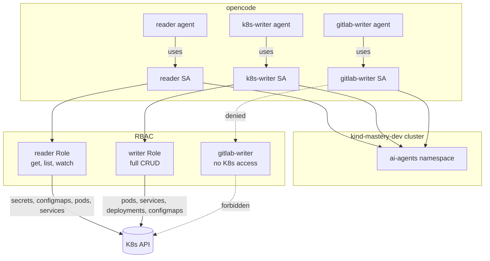
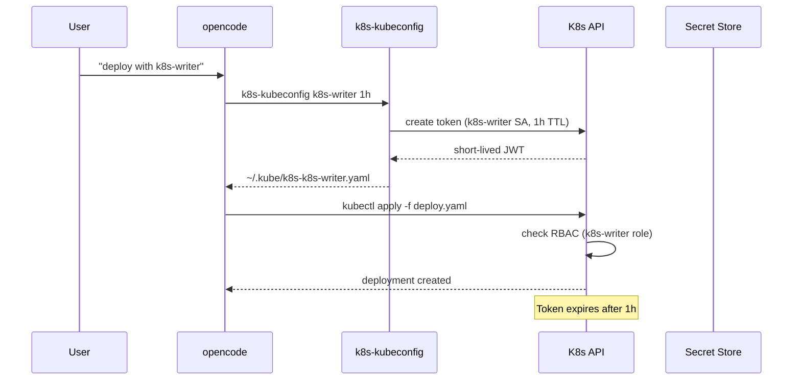
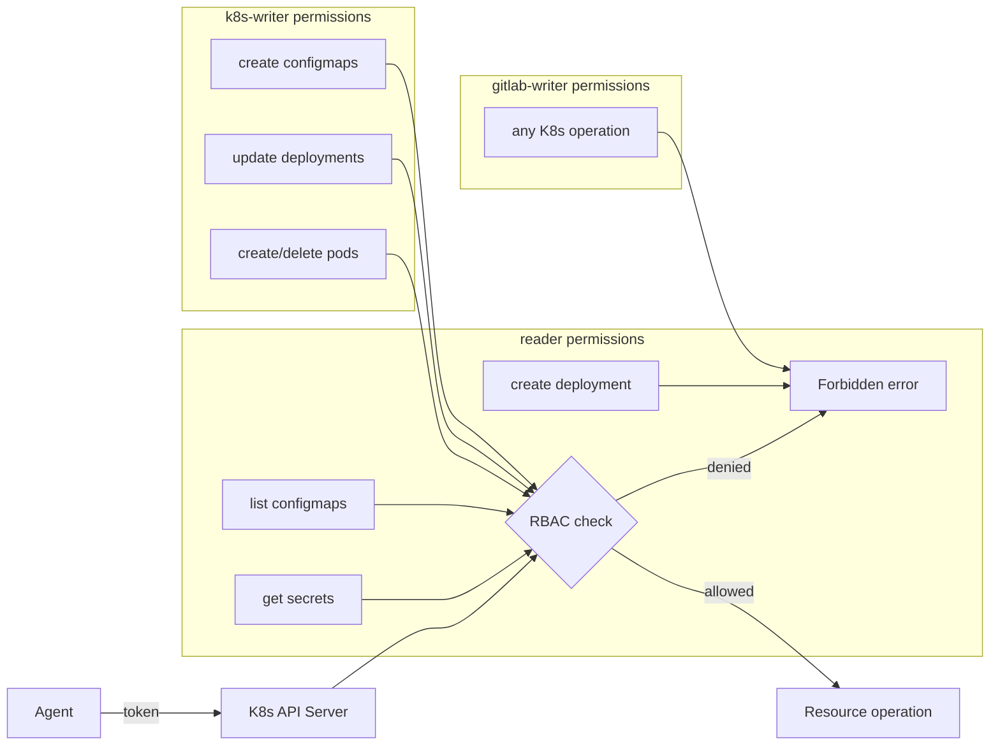
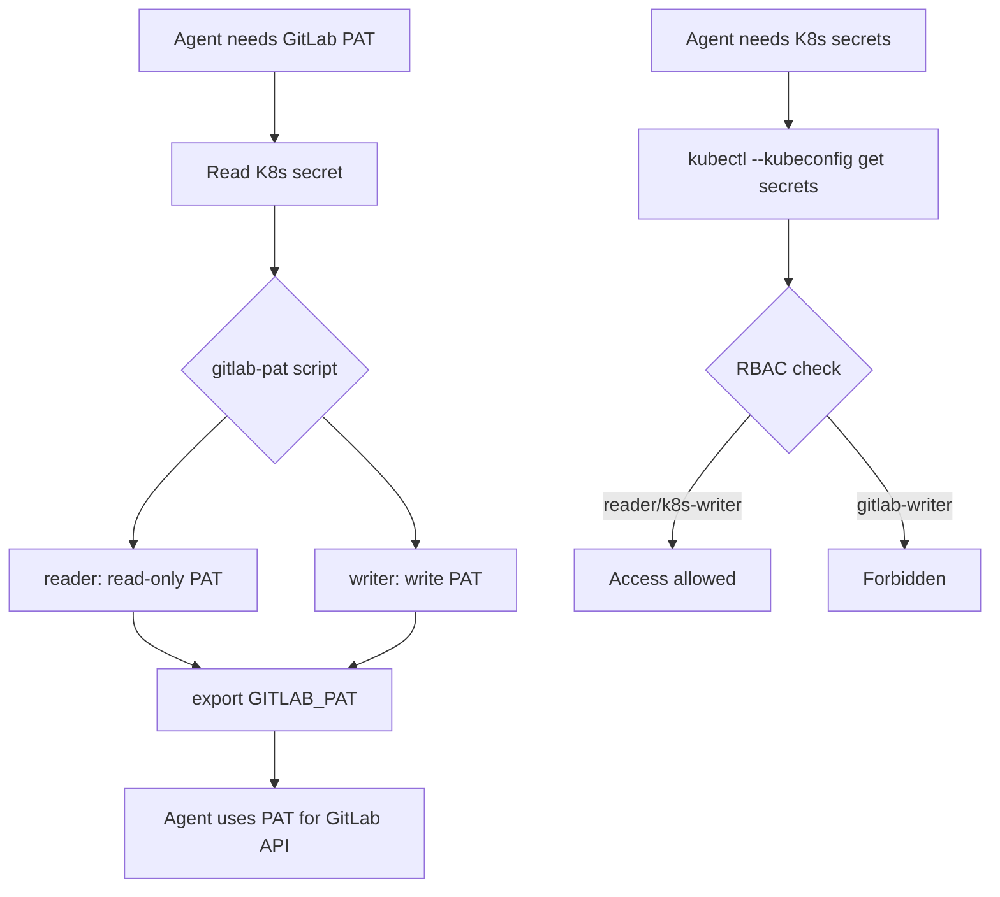

# Agent Identity Architecture

Workload identity for AI agents using Kubernetes ServiceAccounts, RBAC, and short-lived tokens.

## Overview

Each opencode agent gets a unique Kubernetes ServiceAccount (SA) with scoped permissions. Agents never share credentials — their identity is their SA token, which expires automatically.



## Agent → ServiceAccount Mapping

| Agent Role | ServiceAccount | K8s Permissions | GitLab Access |
|------------|---------------|-----------------|---------------|
| `reader` | `ai-agents/reader` | Read-only (secrets, configmaps, pods, services) | No |
| `k8s-writer` | `ai-agents/k8s-writer` | Full CRUD (pods, services, deployments, configmaps, secrets) | No |
| `gitlab-writer` | `ai-agents/gitlab-writer` | None | Via PAT secret |

## Token Lifecycle



## RBAC Enforcement



## Secret Access Pattern



## File Layout

```
openbao/
├── k8s/
│   └── agent-identity.yaml    # SAs, RBAC, secrets
├── k8s-kubeconfig              # SA token → kubeconfig
├── gitlab-pat                  # K8s secret → GitLab PAT
├── k8s-secret                  # Generic K8s secret reader
├── agents/
│   ├── reader.md               # Reader agent config
│   ├── k8s-writer.md           # K8s writer agent config
│   └── gitlab-writer.md        # GitLab writer agent config
└── plugins/
    ├── opencode-openbao/       # OpenBao plugin (deprecated)
    └── opencode-k8s-identity/  # K8s identity plugin

opencode/agents/
├── reader.md                   # Reader agent (copied)
├── k8s-writer.md               # K8s writer agent (copied)
└── gitlab-writer.md            # GitLab writer agent (copied)

skills/k8s-agent-identity/
└── SKILL.md                    # How to use agent identities
```

## Usage

### Generate a kubeconfig

```bash
# Reader (read-only, 1 hour)
bash openbao/k8s-kubeconfig reader

# K8s writer (full CRUD, 30 minutes)
bash openbao/k8s-kubeconfig k8s-writer 30m

# Reader (8 hour session)
bash openbao/k8s-kubeconfig reader 8h
```

### Read GitLab PAT

```bash
# Reader PAT
eval $(bash openbao/gitlab-pat reader)

# Writer PAT
eval $(bash openbao/gitlab-pat writer)
```

### Verify RBAC

```bash
# Should succeed
kubectl --kubeconfig ~/.kube/k8s-reader.yaml get secrets -n ai-agents

# Should fail (Forbidden)
kubectl --kubeconfig ~/.kube/k8s-reader.yaml create configmap test -n ai-agents --from-literal=x=y
```

## Security Properties

1. **No shared credentials** — each agent has its own SA
2. **Short-lived tokens** — auto-expire after TTL (default 1h)
3. **Least privilege** — RBAC scoped to exactly what each agent needs
4. **No privilege escalation** — can't modify RBAC, SAs, or ClusterRoles
5. **Audit trail** — every API call logged with SA identity
6. **No gitlab-writer K8s access** — completely isolated

## Rebuild from scratch

```bash
# Delete and recreate
kubectl --kubeconfig ~/.kube/kind-mastery-dev.yaml delete namespace ai-agents
kubectl --kubeconfig ~/.kube/kind-mastery-dev.yaml apply -f openbao/k8s/agent-identity.yaml

# Regenerate all kubeconfigs
for role in reader k8s-writer gitlab-writer; do
  bash openbao/k8s-kubeconfig "$role" 1h
done
```
